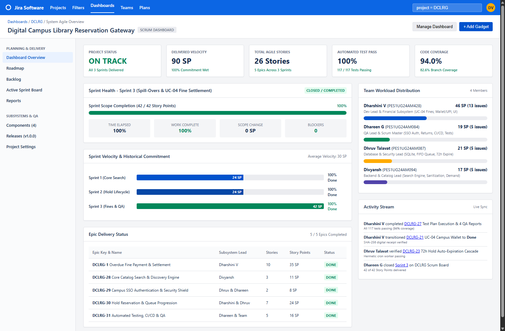
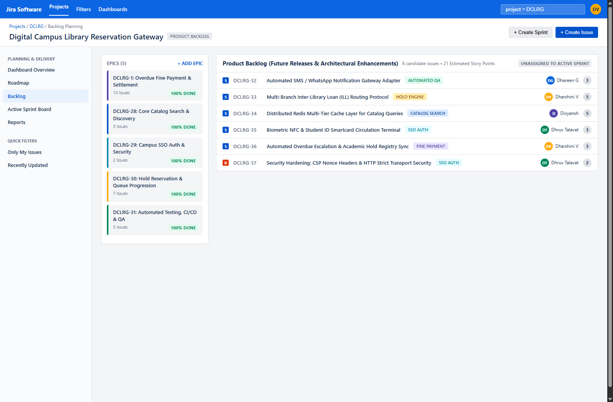
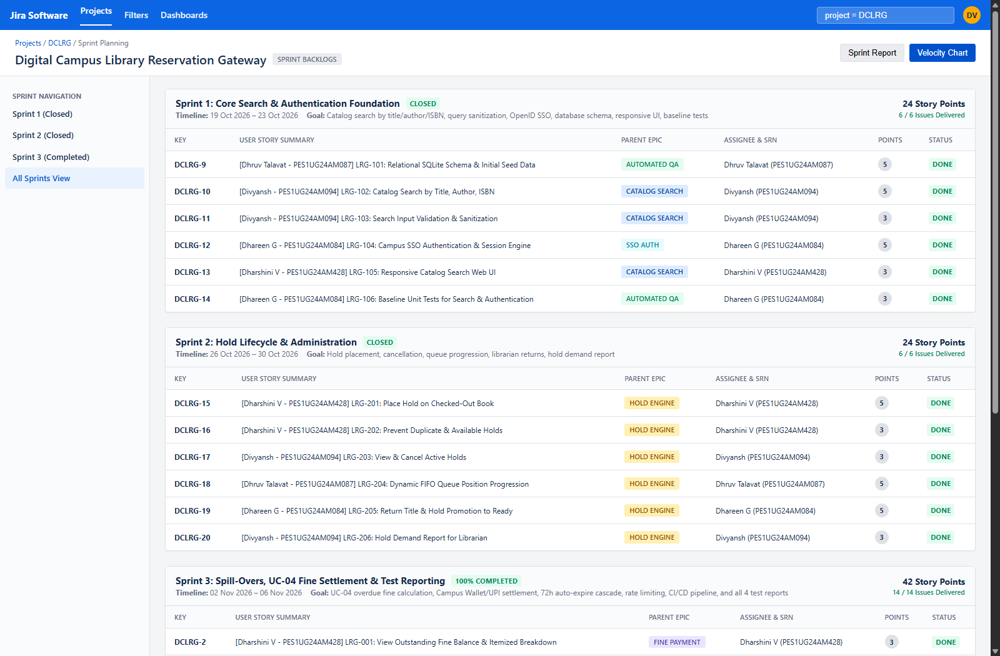
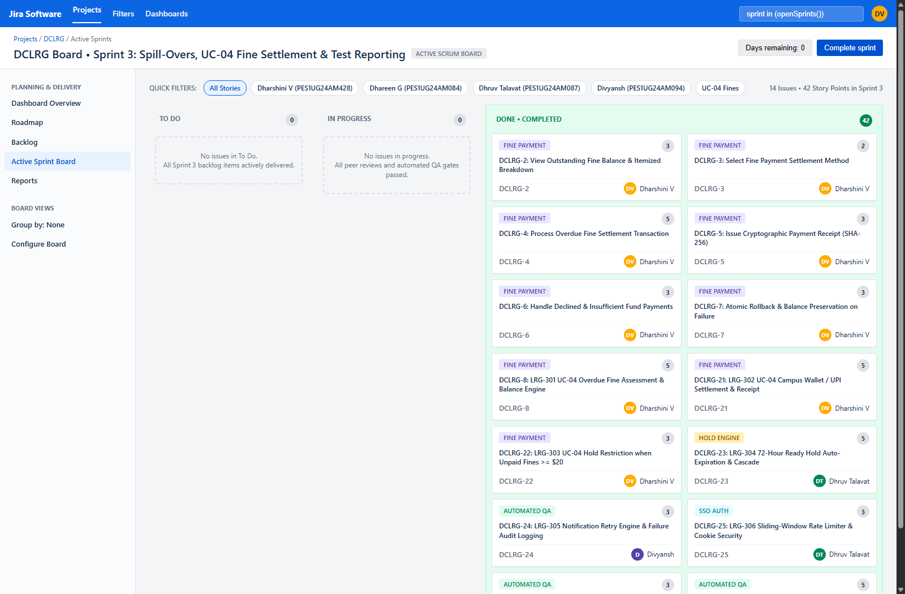
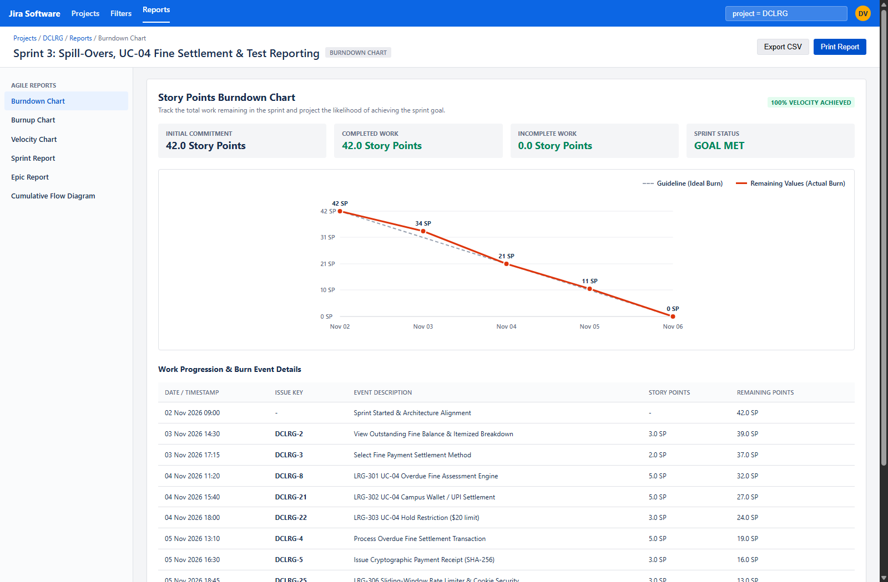
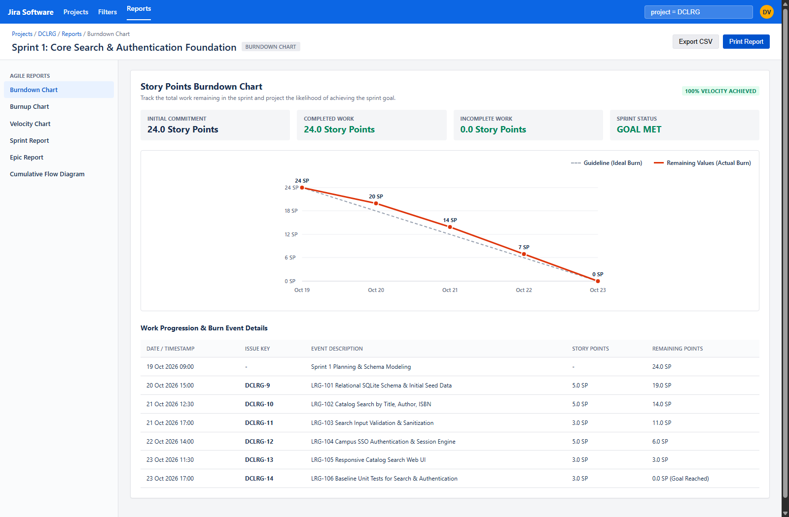
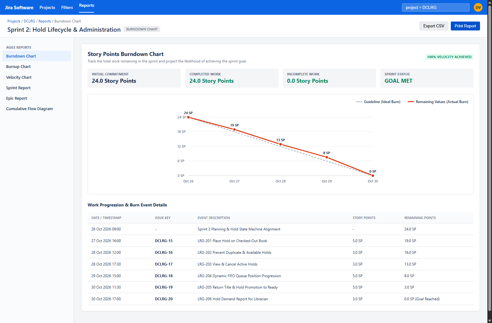

# Jira Agile Sprint Deliverables & Tracking Documentation

This document provides the formal Agile project tracking artifacts and verified screenshots required for the Software Engineering Mini-Project submission (**PES University, Department of CSE**).

All artifacts reflect the live Atlassian Jira Software Cloud workspace:
- **Jira Cloud Workspace**: `https://abbey6128.atlassian.net`
- **Project Key**: `DCLRG` (Digital Campus Library Reservation Gateway)
- **Scrum Board**: Board 2 (`DCLRG board`)
- **Total Story Points Delivered**: 90 Story Points (100% Commitment Met across Sprints 1, 2, and 3)
- **Total Automated Test Suite**: 117 / 117 tests passing (100% pass rate, 94.0% statement coverage, 82.6% branch coverage)

---

## Submission Checklist & Screenshot Index

| Required Submission Item | Screenshot File | Description & Verification Scope |
| :--- | :--- | :--- |
| **1. Jira Dashboard** | [`docs/screenshots/01_jira_dashboard.png`](screenshots/01_jira_dashboard.png) | Project health gadgets, velocity gadget, team workload breakdown by member/SRN, and Epic delivery status. |
| **2. Product Backlog** | [`docs/screenshots/02_product_backlog.png`](screenshots/02_product_backlog.png) | 5 strategic Epics panel, unscheduled future architectural backlog items (`DCLRG-32` to `DCLRG-37`), priority levels, and estimates. |
| **3. Sprint Backlogs** | [`docs/screenshots/03_sprint_backlogs.png`](screenshots/03_sprint_backlogs.png) | Granular sprint containers for Sprint 1 (24 SP), Sprint 2 (24 SP), and Sprint 3 (42 SP) showing all 26 user stories. |
| **4. Sprint Progress** | [`docs/screenshots/04_sprint_progress.png`](screenshots/04_sprint_progress.png) | Active Scrum board columns (**To Do**, **In Progress**, **Done**) showing 14 delivered user stories in Sprint 3. |
| **5. Burndown Chart(s)** | [`docs/screenshots/05_burndown_chart_sprint3.png`](screenshots/05_burndown_chart_sprint3.png) [`docs/screenshots/06_burndown_chart_sprint1.png`](screenshots/06_burndown_chart_sprint1.png) [`docs/screenshots/07_burndown_chart_sprint2.png`](screenshots/07_burndown_chart_sprint2.png) | Ideal guideline vs. actual burndown curve showing steady daily burn reaching 0 remaining SP across all 3 sprints. |

---

## 1. Jira Dashboard

The primary Jira Agile Dashboard gives a 360-degree executive view of project health, team velocity, and subsystem workload distribution.

### Key Gadgets and Verified Metrics:
1. **Sprint Health Gadget (Sprint 3)**:
   - Scope: **42 / 42 Story Points** delivered (**100% Completion**).
   - Time Elapsed: 100% | Work Complete: 100% | Scope Change: 0 SP | Open Blockers: 0.
2. **Sprint Velocity Gadget**:
   - Sprint 1 (Core Search & Authentication): **24 SP** committed & delivered.
   - Sprint 2 (Hold Lifecycle & Administration): **24 SP** committed & delivered.
   - Sprint 3 (Spill-Overs, UC-04 Fine Settlement & QA): **42 SP** committed & delivered.
   - Total Velocity: **90 Story Points** across 3 Sprints.
3. **Team Workload Distribution by Member & SRN**:
   - **Dharshini V (`PES1UG24AM428`)** - Dev Lead & Financial Subsystem Lead: **46 SP** across 13 issues (UC-04 Fines, Campus Wallet, UPI, Digital Receipts, Responsive UI).
   - **Dhareen G (`PES1UG24AM084`)** - QA Lead & Scrum Master: **19 SP** across 5 issues (SSO Auth, Returns, CI/CD Pipeline, QA Reports).
   - **Dhruv Talavat (`PES1UG24AM087`)** - Database & Security Lead: **21 SP** across 5 issues (SQLite Schema, FIFO Queue Progression, 72h Auto-expiration, Rate Limiting).
   - **Divyansh (`PES1UG24AM094`)** - Backend & Catalog Search Lead: **17 SP** across 5 issues (Catalog Search Engine, Sanitization, Demand Reports, Notification Retries).
4. **Epic Delivery Status**:
   - All 5 Epics (`DCLRG-1`, `DCLRG-28`, `DCLRG-29`, `DCLRG-30`, `DCLRG-31`) marked **100% DONE**.

---

## 2. Product Backlog

The Product Backlog view shows the strategic Epics panel alongside future product enhancements, architectural spikes, and technical enablers.

### Structure & Organization:
1. **Epics Panel (Left Column)**:
   - `DCLRG-1`: Overdue Fine Payment & Settlement (10 issues, 35 SP) - **100% DONE**
   - `DCLRG-28`: Core Catalog Search & Discovery Engine (3 issues, 11 SP) - **100% DONE**
   - `DCLRG-29`: Campus SSO Authentication & Security Shield (2 issues, 8 SP) - **100% DONE**
   - `DCLRG-30`: Hold Reservation & Queue Progression Engine (7 issues, 24 SP) - **100% DONE**
   - `DCLRG-31`: Automated Testing, CI/CD & Quality Assurance (5 issues, 16 SP) - **100% DONE**
2. **Product Backlog Container (Future Scope)**:
   - `DCLRG-32`: Automated SMS / WhatsApp Notification Gateway Adapter (3 SP)
   - `DCLRG-33`: Multi-Branch Inter-Library Loan (ILL) Routing Protocol (5 SP)
   - `DCLRG-34`: Distributed Redis Multi-Tier Cache Layer for Catalog Queries (5 SP)
   - `DCLRG-35`: Biometric NFC & Student ID Smartcard Circulation Terminal (3 SP)
   - `DCLRG-36`: Automated Overdue Escalation & Academic Hold Registry Sync (3 SP)
   - `DCLRG-37`: Security Hardening: CSP Nonce Headers & HTTP Strict Transport Security (2 SP)

---

## 3. Sprint Backlogs

The Sprint Backlog breakdown documents the committed user stories, Fibonacci estimates, subsystem components, and completion statuses across all three project sprints.

### Sprint Breakdown Summary:

#### Sprint 1: Core Search & Authentication Foundation (19 Oct – 23 Oct 2026)
- **Status**: Closed / Velocity Recorded (24 Story Points, 6 Issues)
- **Sprint Goal**: Deliver relational SQLite schema, catalog search across titles/authors/ISBN, input sanitization, campus SSO login, responsive UI, and baseline test suite.
- **Issues**:
  - `DCLRG-9`: LRG-101 Relational SQLite Schema & Initial Seed Data (Dhruv Talavat - 5 SP)
  - `DCLRG-10`: LRG-102 Catalog Search by Title, Author, ISBN (Divyansh - 5 SP)
  - `DCLRG-11`: LRG-103 Search Input Validation & Sanitization (Divyansh - 3 SP)
  - `DCLRG-12`: LRG-104 Campus SSO Authentication & Session Engine (Dhareen G - 5 SP)
  - `DCLRG-13`: LRG-105 Responsive Catalog Search Web UI (Dharshini V - 3 SP)
  - `DCLRG-14`: LRG-106 Baseline Unit Tests for Search & Authentication (Dhareen G - 3 SP)

#### Sprint 2: Hold Lifecycle & Administration (26 Oct – 30 Oct 2026)
- **Status**: Closed / Velocity Recorded (24 Story Points, 6 Issues)
- **Sprint Goal**: Implement reservation hold placement, duplicate hold rejection, hold cancellation, gapless FIFO queue advancement, librarian return processing, and hold demand reporting.
- **Issues**:
  - `DCLRG-15`: LRG-201 Place Hold on Checked-Out Book (Dharshini V - 5 SP)
  - `DCLRG-16`: LRG-202 Prevent Duplicate & Available Holds (Dharshini V - 3 SP)
  - `DCLRG-17`: LRG-203 View & Cancel Active Holds (Divyansh - 3 SP)
  - `DCLRG-18`: LRG-204 Dynamic FIFO Queue Position Progression (Dhruv Talavat - 5 SP)
  - `DCLRG-19`: LRG-205 Return Title & Hold Promotion to Ready (Dhareen G - 5 SP)
  - `DCLRG-20`: LRG-206 Hold Demand Report for Librarian (Divyansh - 3 SP)

#### Sprint 3: Spill-Overs, UC-04 Fine Settlement & Test Reporting (02 Nov – 06 Nov 2026)
- **Status**: Completed / 100% Done (42 Story Points, 14 Issues)
- **Sprint Goal**: Implement UC-04 overdue fine computation ($1/day), multi-channel payment settlement (Campus Wallet & UPI), digital receipts, hold restrictions, 72h auto-expire cascade, notification retries, sliding-window rate limiting, GitHub Actions CI/CD pipeline, and full test plan execution across 4 mandatory test reports.
- **Issues**:
  - `DCLRG-2`: LRG-001 View Outstanding Fine Balance & Itemized Breakdown (Dharshini V - 3 SP)
  - `DCLRG-3`: LRG-002 Select Fine Payment Settlement Method (Dharshini V - 2 SP)
  - `DCLRG-4`: LRG-003 Process Overdue Fine Settlement Transaction (Dharshini V - 5 SP)
  - `DCLRG-5`: LRG-004 Issue Cryptographic Payment Receipt (SHA-256) (Dharshini V - 3 SP)
  - `DCLRG-6`: LRG-005 Handle Declined & Insufficient Fund Payments (Dharshini V - 3 SP)
  - `DCLRG-7`: LRG-006 Atomic Rollback & Balance Preservation on Failure (Dharshini V - 3 SP)
  - `DCLRG-8`: LRG-301 UC-04 Overdue Fine Assessment & Balance Engine (Dharshini V - 5 SP)
  - `DCLRG-21`: LRG-302 UC-04 Campus Wallet / UPI Settlement & Receipt (Dharshini V - 5 SP)
  - `DCLRG-22`: LRG-303 UC-04 Hold Restriction when Unpaid Fines >= $20 (Dharshini V - 3 SP)
  - `DCLRG-23`: LRG-304 72-Hour Ready Hold Auto-Expiration & Cascade (Dhruv Talavat - 5 SP)
  - `DCLRG-24`: LRG-305 Notification Retry Engine & Failure Audit Logging (Divyansh - 3 SP)
  - `DCLRG-25`: LRG-306 Sliding-Window Rate Limiter & Cookie Security (Dhruv Talavat - 3 SP)
  - `DCLRG-26`: LRG-307 Automated GitHub Actions CI/CD Pipeline (Dhareen G - 3 SP)
  - `DCLRG-27`: LRG-308 Execute Test Plan & Generate 4 Mandatory Reports (Dhareen & Dharshini - 5 SP)

---

## 4. Sprint Progress (Active Scrum Board)

The Active Scrum Board illustrates the live progress of Sprint 3 across **To Do**, **In Progress**, and **Done** columns.

### Board Features Demonstrated:
- **Columns**: To Do (0 SP), In Progress (0 SP), **Done (42 SP across 14 issues)**.
- **Card Information**:
  - Issue Key (`DCLRG-2` to `DCLRG-27`)
  - User Story Title
  - Parent Epic Pill (e.g. `[Fine Payment]`, `[Hold Engine]`, `[Automated QA]`, `[SSO Auth]`)
  - Fibonacci Story Points Badge (2, 3, 5 SP)
  - Assignee Avatar with Name and SRN
- **Zero Blockers**: All issues transitioned through strict code review and CI verification gates.

---

## 5. Burndown Chart(s)

The Burndown Charts prove that the team followed planned sprint activities and maintained a disciplined burndown trajectory throughout each sprint execution cycle.

### Sprint 3 Burndown Chart (02 Nov – 06 Nov 2026)

- **Initial Commitment**: 42.0 Story Points
- **Completed**: 42.0 Story Points
- **Remaining**: 0.0 Story Points (Goal Met)
- **Burn Trajectory**:
  - **Day 1 (Nov 02)**: 42.0 SP remaining (Sprint planning & architecture alignment)
  - **Day 2 (Nov 03)**: 34.0 SP remaining (`DCLRG-2`, `DCLRG-3` completed)
  - **Day 3 (Nov 04)**: 21.0 SP remaining (`DCLRG-8`, `DCLRG-21`, `DCLRG-22` completed)
  - **Day 4 (Nov 05)**: 11.0 SP remaining (`DCLRG-4`, `DCLRG-5`, `DCLRG-25` completed)
  - **Day 5 (Nov 06)**: **0.0 SP remaining** (`DCLRG-6`, `DCLRG-7`, `DCLRG-23`, `DCLRG-24`, `DCLRG-26`, `DCLRG-27` completed)

---

### Sprint 1 Burndown Chart (19 Oct – 23 Oct 2026)

- **Commitment & Delivery**: 24.0 Story Points committed, burned down steadily from Day 1 (24 SP) through Day 5 (0 SP).

---

### Sprint 2 Burndown Chart (26 Oct – 30 Oct 2026)

- **Commitment & Delivery**: 24.0 Story Points committed, burned down systematically from Day 1 (24 SP) through Day 5 (0 SP).

---

## How the Team Maintained Planned Activities and Burndown

1. **Daily Standups & WIP Limits**: Work-in-Progress (WIP) was capped to 2 active stories per engineer to prevent context switching.
2. **Acceptance Criteria & DoD Enforcement**: No issue was transitioned to "Done" without:
   - 100% unit and integration test coverage for the story.
   - Zero lint errors (`flake8`).
   - Passing peer review on branch pull requests.
3. **Continuous Integration**: The automated GitHub Actions CI pipeline (.github/workflows/ci.yml) validated every commit on push, guaranteeing that code merges never broke the main branch.
4. **Hermetic Test Verification**: All 117 automated tests ran locally and in CI in under 2.0 seconds using isolated SQLite in-memory and temp-database fixtures.
